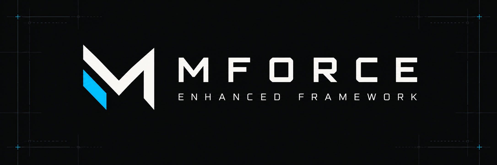

<p align="center">


</p>
<p align="center">


</p>
<p align="center">


</p>
<!-- Automatically refreshed on pushes to main via .github/workflows/repository-stats.yml.
     Counts use Git-tracked files/directories and non-empty lines in source files
     (.sh, .bash, .py, .js, .jsx, .ts, .tsx, .html, .css, .sql), including tests/comments.
     Shields.io may cache values briefly. -->

<p align="center">


</p>
<p align="center">


</p>
<p align="center"><a href="https://github.com/GotUrBack-Public/MForce-Enhanced-Framework/pulls?q=is%3Apr+is%3Amerged">Merges</a> · <a href="https://github.com/GotUrBack-Public/MForce-Enhanced-Framework/graphs/contributors">Contributors</a></p>


--------------


<p align="center"></p>

---

# MForce Enhanced Framework – Comprehensive Modular Penetration Testing & Red Teaming Framework

**MForce Enhanced Framework** is an extensive open-source **penetration testing framework**, **automated reconnaissance toolkit** and **red teaming** companion for **authorized** security assessments. It bundles **vulnerability assessment**, **network reconnaissance**, **OSINT**, **security auditing** and **exploitation-adjacent** tooling into a single modular, menu-driven interface built for **Kali Linux**, **Termux**, **Ubuntu**, **Debian** and other Linux distributions. Whether you run **automated reconnaissance**, **security auditing**, or structured **red teaming** workflows, MForce keeps every check bounded, low-impact and audit-friendly.

> ⚠️ **Authorized use only.** MForce is an educational and professional security toolkit. Use it exclusively against systems you own or are explicitly authorized to test. Every module enforces scope flags (`--authorized`, `--allow-public`), never bypasses rate limits, and is designed for GDPR-conscious, data-minimizing workflows.

## 📑 Table of Contents

- [Key Features](#-key-features)
- [Badges & Project Status](#-badges--project-status)
- [Modules & Integrated Tools](#-modules--integrated-tools)
  - [Network Reconnaissance](#network-reconnaissance)
  - [OSINT & Web Intelligence](#osint--web-intelligence)
  - [Offensive Security & Exploitation Labs](#offensive-security--exploitation-labs)
  - [Defensive Security](#defensive-security)
  - [System, Updates & Utilities](#system-updates--utilities)
  - [Integrated External Tools](#integrated-external-tools)
  - [Plugin Catalog](#plugin-catalog)
- [Architecture / Directory Structure](#-architecture--directory-structure)
- [Installation](#-installation)
- [Usage Examples](#-usage-examples)
- [Supported Platforms](#-supported-platforms)
- [Testing](#-testing)
- [Roadmap](#-roadmap)
- [Contributing](#-contributing)
- [Security & Responsible Disclosure](#-security--responsible-disclosure)
- [License](#-license)

## ✨ Key Features

- **Modular architecture** – 23 registered functional modules across 9 categories, plus a 23-entry plugin manifest catalog with a JSON-driven registry.
- **Automated reconnaissance** – DNS records, IP intelligence, TLS certificates, HTTP headers, RDAP/registration data and network information in one pass.
- **Vulnerability assessment & auditing** – CORS policy auditing, HTTP method auditing, cookie flag auditing, exposure-path review and HTTP reflection inspection.
- **Offensive security labs** – TCP port scanner and a 100-example XSS payload lab (local only, no automatic injection).
- **OSINT & web intelligence** – website inspector, API metadata, JavaScript DOM review, robots/sitemap parsing and rate-limit signal detection.
- **Defensive security** – offline local secret scanner that never exfiltrates matched values.
- **Menu-driven TUI** – keyboard-friendly terminal UI with accessibility and reduced-motion support.
- **Safety-first design** – bounded request counts, no rate-limit bypass, no stealth or firewall evasion, scope enforcement flags, and privacy/GDPR guidance in every module.
- **Cross-platform** – runs on Termux (Android/ARM) and desktop Linux (x86_64).
- **Developer tooling** – read-only Python CLI (`doctor`, `catalog`, `describe`, `stats`) and a full automated test suite.

## 🏷️ Badges & Project Status

<p align="center">


</p>

## 🧩 Modules & Integrated Tools

MForce organizes capabilities into **9 categories** (see `src/data/cats.json`) and **23 functional modules** (see `src/data/funcs.json`). Each module ships with its own `.conf`, `.help`, `.json` metadata and `.sh` entry under `src/lib/`.

### Network Reconnaissance

| ID | Module | Entry Script | Category | Description |
|----|--------|--------------|----------|-------------|
| `frc386` | Network Information | `lar386.sh` | Network | Displays network interfaces and current hostname. |
| `dns211` | DNS Records | `dns211.sh` | Network | A/AAAA, MX, NS, TXT, CAA, CNAME and SOA lookups (optional `dig`). |
| `ipa212` | IP Intelligence | `ipa212.sh` | Network | IP family, public/non-public classification and reverse DNS. |
| `tls213` | TLS Certificate | `tls213.sh` | Network | Verified TLS connection, certificate expiry, cipher and SAN names. |
| `hdr214` | HTTP Headers | `hdr214.sh` | Network | Security response headers, HTTP metadata, cookies and rate-limit hints. |
| `frc742` | Connection Test | `qtx742.sh` | Network | Connectivity check (disabled by default). |

### OSINT & Web Intelligence

| ID | Module | Entry Script | Category | Description |
|----|--------|--------------|----------|-------------|
| `web311` | Website Inspector | `web311.sh` | OSINT | Passive HTML/HTTP audit, forms, metadata, rate signals and DOM sink detection. |
| `api312` | API Metadata | `api312.sh` | OSINT | Read-only public JSON key types, CORS indicators and security headers. |
| `rat313` | Rate Limit Signals | `rat313.sh` | OSINT | Detects 429 and RateLimit/Retry-After headers (no stress testing). |
| `jsn314` | JavaScript DOM Review | `jsn314.sh` | OSINT | Static `innerHTML`/`eval` sink pattern review (not XSS proof). |
| `rob315` | Robots & Sitemap | `rob315.sh` | OSINT | Reads `robots.txt` and `sitemap.xml` summaries without crawling. |
| `rdp316` | RDAP Registration | `rdp316.sh` | OSINT | Registration data via `rdap.org` (target disclosed to external provider). |
| `osn521` | OSINT Search | `rpx521.sh` | OSINT | OSINT search helper (disabled by default). |

### Offensive Security & Exploitation Labs

| ID | Module | Entry Script | Category | Description |
|----|--------|--------------|----------|-------------|
| `tcp401` | TCP Port Scanner | `tcp401.sh` | Offensive | Bounded TCP connect scan (default 19 ports, max 128, 8 workers, 3s timeout). |
| `xss402` | XSS Payload Lab | `xss402.sh` | Offensive | Local library of 100 contextual XSS examples; no network, no auto-injection. |
| `ref403` | HTTP Reflection Inspector | `ref403.sh` | Offensive | Bounded GET reflection check with a harmless unique marker (max 8 requests). |
| `cor404` | CORS Policy Auditor | `cor404.sh` | Offensive | Authorized CORS header audit with inert test origins (2 bounded GETs). |
| `met405` | HTTP Method Auditor | `met405.sh` | Offensive | Authorized `OPTIONS` inspector reporting `Allow`/CORS method headers. |
| `coo406` | Cookie Flag Auditor | `coo406.sh` | Offensive | Authorized cookie attribute review (Secure, HttpOnly, SameSite); never prints values. |
| `pth407` | Exposure Path Auditor | `pth407.sh` | Offensive | Bounded HEAD-only review of five fixed exposure paths; never downloads content. |

### Defensive Security

| ID | Module | Entry Script | Category | Description |
|----|--------|--------------|----------|-------------|
| `sec601` | Local Secret Scanner | `sec601.sh` | Defensive | Offline secret-pattern scanner (up to 250 files, 1 MiB each); reports path/line/rule only. |

### System, Updates & Utilities

| ID | Module | Entry Script | Category | Description |
|----|--------|--------------|----------|-------------|
| `sys193` | System Information | `vkn193.sh` | System | Android, Termux, kernel, architecture and runtime information. |
| `upd501` | Update MForce | `upd501.sh` | Updates | Git fast-forward updater to the latest official `main` commit (never force-resets). |

> Categories `util`, `file` and `cfg` (Utilities, Files, Settings) are registered in `src/data/cats.json` and surfaced through the plugin catalog and TUI.

### Integrated External Tools

| Tool | ID | Category | Description |
|------|----|----------|-------------|
| **Nmap** | `nmap` | Network | Guided host discovery and bounded TCP port/service checks for authorized targets (see `src/tools/catalog.json`, `src/tools/nmap.lib`, `docs/NMAP.md`). |

### Plugin Catalog

The `src/plugins/` tree contains **23 plugin manifests** (`manifest.json`) grouped by category, each with a dedicated `README.md`:

| Category | Plugins |
|----------|---------|
| `net` | `dns211`, `frc386`, `frc742`, `hdr214`, `ipa212`, `tls213` |
| `osint` | `api312`, `jsn314`, `osn521`, `rat313`, `rdp316`, `rob315`, `web311` |
| `offensive` | `coo406`, `cor404`, `met405`, `pth407`, `ref403`, `tcp401`, `xss402` |
| `defensive` | `sec601` |
| `sys` | `sys193` |
| `upd` | `upd501` |

## 🏗️ Architecture / Directory Structure

```text
MForce-Enhanced-Framework/
├── xrm742.sh                 # Main entrypoint (starts MariaDB, launches TUI)
├── install.sh                # One-shot installer (git clone + launcher)
├── src/
│   ├── auth/                 # Login / session handling
│   ├── colors/               # Theme, colors and status UI helpers
│   ├── core/                 # Runtime, MariaDB lifecycle, schema, tool manager
│   ├── data/                 # cats.json, funcs.json, cfg.json registries
│   ├── defensive/            # secrets_audit.py
│   ├── functions/            # Thin module entry scripts (e.g. dns211.sh)
│   ├── lib/                  # Per-module .conf/.help/.json/.sh implementations
│   ├── mforce/               # Python package: CLI, catalog, diagnostics, metrics
│   ├── offensive/            # http_audit, reflection, tcp_scan, xss_lab (Python)
│   ├── osint/                # inspect.py
│   ├── plugins/              # 23 plugin manifests grouped by category
│   ├── tools/                # catalog.json + nmap.lib adapter
│   ├── ui/                   # TUI (epos.sh, theme.lib, menus)
│   └── update/               # updater.py
├── tests/                    # Full unittest + JS interaction test suite
├── docs/                     # Architecture, module authoring, NMAP, OSINT, etc.
├── .github/                  # CI workflows, issue & PR templates, Dependabot
├── cfg/                      # zrk391.json (name/version/license/platform)
└── web/, academy/, social/   # Web portal, academy content, community docs
```

## 🚀 Installation

### Quick install (Termux / Linux)

```bash
git clone https://github.com/GotUrBack-Public/MForce-Enhanced-Framework.git
cd MForce-Enhanced-Framework
./install.sh
```

The installer clones into `~/.local/share/mforce-enhanced-framework` and creates a `mforce` launcher in `~/.local/bin`.

### Run directly

```bash
./xrm742.sh
```

### Runtime dependencies

`bash`, `jq`, `python3` (or `python`), `coreutils`, `ncurses`, `iproute2`, and `git` (for updates). Nmap is optional and only required for the Nmap adapter.

## 💻 Usage Examples

Launch the interactive menu:

```bash
./xrm742.sh
```

Run individual modules directly (examples taken from each module's `--help`):

```bash
# DNS records for an authorized target
bash src/functions/dns211.sh example.org

# TLS certificate inspection
bash src/functions/tls213.sh example.org

# Website inspector (passive HTML/HTTP audit)
bash src/functions/web311.sh https://example.org

# TCP port scanner (authorized, bounded)
bash src/functions/tcp401.sh 192.168.1.10 --authorized --ports 22,80,443

# CORS policy audit (authorized, JSON output)
bash src/functions/cor404.sh http://127.0.0.1:8000 --authorized --json

# Local offline secret scan
bash src/functions/sec601.sh ./project --json

# XSS payload lab (local only)
bash src/functions/xss402.sh --list-categories
bash src/functions/xss402.sh --category html
```

Read-only developer CLI (Python package):

```bash
python3 -m src.mforce doctor
python3 -m src.mforce catalog --category offensive
python3 -m src.mforce describe tcp401
python3 -m src.mforce stats
```

## 📱 Supported Platforms

| Platform | Architecture | Status |
|----------|--------------|--------|
| Termux (Android) | ARM | ✅ Primary target |
| Ubuntu | x86_64 | ✅ Supported |
| Debian | x86_64 | ✅ Supported |
| Kali Linux | x86_64 | ✅ Supported |
| Other Linux | x86_64 | ⚠️ Best effort |

## 🧪 Testing

```bash
python3 -m unittest discover -s tests -v
```

The suite covers the modular catalog, doctor/metrics, registry integrity, TCP scanning, XSS/reflection, the updater, MariaDB privacy, the Nmap adapter, the website/academy portals and more.

## 🗺️ Roadmap

See `docs/BIG_UPDATE_ROADMAP.md` for the full plan. Highlights:

- Expand the plugin catalog and third-party tool adapters.
- Grow the OSINT and defensive-security module families.
- Improve accessibility and reduced-motion TUI behavior.
- Broaden automated test coverage and CI hardening.
- Publish additional documentation and academy material.

## 🤝 Contributing

Contributions of reproducible bug fixes, Termux/Linux compatibility work, well-scoped modules, accessibility and documentation improvements are welcome. See [CONTRIBUTING.md](CONTRIBUTING.md), the [full contribution guide](social/how_to_contribute.md) and [docs/MODULE_AUTHORING.md](docs/MODULE_AUTHORING.md).

```bash
# Before opening a PR
python3 -m unittest discover -s tests -v
```

## 🔐 Security & Responsible Disclosure

Do **not** open public issues for security vulnerabilities. Follow [SECURITY.md](SECURITY.md). Project data handling is documented in [DSGVO/](DSGVO/README.md). All modules are intended for **authorized, educational and professional** use only.

## 📄 License

Released under the [MIT License](LICENSE) © 2026 Damian Proksch.
